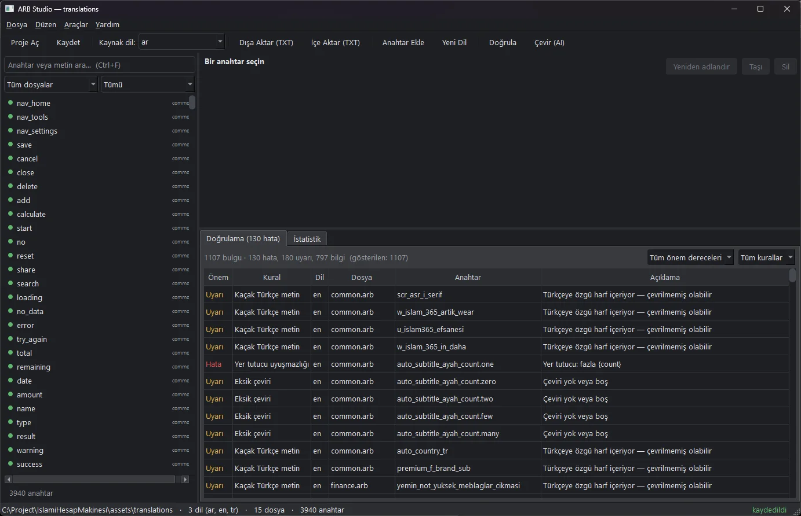

# ARB Studio

[Türkçe](README.tr.md)

A desktop editor for Flutter's `.arb` translation files. All languages and files in one window, a validator that catches broken placeholders and missing translations, and a TXT round trip for handing text to a translator.

I wrote it for [İslam 365](https://islam365.app), whose Turkish, English and Arabic strings are spread over 15 files and thousands of keys. It works with any Flutter project that uses ARB files.

 -green) 



> The interface is in Turkish.

## Contents

- [Getting started](#getting-started)
- [Translating through TXT](#translating-through-txt)
- [Validation](#validation)
- [Other features](#other-features)
- [Batch translation with Claude](#batch-translation-with-claude)
- [Keyboard shortcuts](#keyboard-shortcuts)
- [Byte-for-byte saving](#byte-for-byte-saving)
- [Supported project layouts](#supported-project-layouts)
- [Development](#development)

## Getting started

### Windows executable

Download `ArbStudio.exe` from the [Releases](../../releases) page. It is a single file of about 56 MB and does not need Python. To open a folder directly, drag it onto the exe.

### From source

You need Python 3.10 or newer.

```powershell
git clone https://github.com/umitturkmen/ArbStudio.git
cd ArbStudio
.\run.bat
```

`run.bat` creates a virtual environment on the first run (PySide6 is about 120 MB) and then opens the app. To set it up by hand and open a project folder straight away:

```powershell
python -m venv .venv
.venv\Scripts\pip install -r requirements.txt
.venv\Scripts\python -m arbstudio path\to\your_app\assets\translations
```

## Translating through TXT

The main workflow: export all strings of one language, translate them anywhere, and import them back in the same order.

1. **Export (Ctrl+E):** pick the language, the scope (whole project, one `.arb` file or the keys selected in the list) and the format.
2. Translate the TXT file with any tool or person you like.
3. **Import (Ctrl+I):** pick the file and the target language, then press **Çözümle** (Analyze). You get a line-by-line preview, and the values go in only after you confirm.
4. Write to disk with **Ctrl+S**.

### Two formats

| Format | Looks like | Use it when |
|---|---|---|
| **Line based** (default) | Line N is the value of key N | Pasting into a batch translation tool |
| **Key + TAB + value** | `nav_home<TAB>Home` | Order may change, or you want to open it in Excel |

The format is detected automatically on import.

### Escaping (line-based format)

Each value has to fit on one line, so three sequences are escaped:

| Real | In the TXT |
|---|---|
| line break | `\n` |
| tab | `\t` |
| backslash | `\\` |

Put a line break wherever you see `\n` in the translation and leave the rest alone. The conversion is fully reversible: every key in İslam 365, multi-line values included, survives the round trip unchanged (`tests/test_txt_roundtrip.py`).

### Alignment check

Each export writes a `<name>.arbmap.json` next to the TXT with the key order, the line count and a placeholder fingerprint for every line. On import ARB Studio:

- warns when the line count does not match,
- shows the first line where the drift was detected, with the source and the incoming text side by side,
- and asks for confirmation before writing anything.

## Validation

**Ctrl+R** runs the checks. Double-click a finding in the bottom panel to jump to its key.

| Rule | Catches |
|---|---|
| Placeholder mismatch | `{count}` is in the source but missing in the translation, or the other way round |
| Missing translation | The key is absent or empty in the target language |
| Same as source | The value is an exact copy, probably untranslated |
| Incomplete plural group | `.one` exists but `.other` does not |
| Parity | A key or file exists in one language but not the other |
| Inconsistent translation | The same source text was translated in different ways |
| Whitespace difference | Leading or trailing spaces differ from the source |
| Stray Turkish text | A non-Turkish value that contains `ğşıçöü` |

## Other features

- **Key management:** add (Ctrl+N), rename (F2), delete and move a key to another `.arb` file. Every change is applied to all languages at once.
- **New language:** copies every `.arb` file of the source language with the same keys in the same order, leaves the values empty and sets `@@locale`. It then lists the Flutter-side steps you still need (`l10n.dart`, `pubspec.yaml`, Android `locales_config.xml`, iOS `CFBundleLocalizations`). ARB Studio does not touch those files.
- **Search and filters:** **Ctrl+F** searches keys and values. Filter by file, or by All, Untranslated, Same as source, With placeholders and Has issues. Every key in the list has a status dot and a file badge.
- **Statistics:** a language × file matrix showing how complete each file is.

## Batch translation with Claude

Enter your Anthropic API key under **Araçlar → Çeviri Ayarları** (Tools → Translation Settings). If the `ANTHROPIC_API_KEY` environment variable is set, it takes priority. Then press **Çevir (AI)**:

- Choose the scope: untranslated keys, values identical to the source, the whole project, one file or the selected keys.
- It runs in the background with a progress bar and a stop button.
- Every returned line is checked for placeholders. Lines that break them are marked red and are not selected by default.
- Nothing is written directly. You approve each line in a side-by-side preview.
- Token usage and an estimated cost are shown.

The key is stored in your Windows user settings, never in the project folder. The translation prompt is written for İslam 365; change `SYSTEM_PROMPT` in `arbstudio/services/translator.py` to describe your own app.

## Keyboard shortcuts

| Shortcut | Action |
|---|---|
| `Ctrl+O` | Open project |
| `Ctrl+S` | Save |
| `Ctrl+F` | Search |
| `Ctrl+Enter` | Next untranslated key |
| `Ctrl+E` / `Ctrl+I` | Export / import |
| `Ctrl+N` / `F2` | Add / rename key |
| `Ctrl+R` | Validate |
| `F5` | Reload project |

## Byte-for-byte saving

When reading a file, ARB Studio records its line endings (CRLF or LF), indentation, BOM, ASCII escaping and trailing newline, and writes them back the same way. A file you did not change keeps the same bytes even when it is saved again, so `git diff` shows only the lines you actually edited.

Before saving, a `.arb.bak` backup is left next to each file. The included `.gitignore` already ignores them.

## Supported project layouts

The language code of each file is found in this order:

1. **Folder name:** `assets/translations/tr/common.arb` → `tr`
2. **File name suffix:** `lib/l10n/app_tr.arb` → `tr`, with `app.arb` as the template
3. **`@@locale` field**, if neither of the above works

A file with broken JSON does not stop the project from loading. It is skipped and reported when the project opens.

## Development

```powershell
.venv\Scripts\python -m pytest
```

Some tests run against the İslam 365 translations and are skipped when that folder is not on your machine.

To build the single-file exe, run `build_exe.bat`. It uses PyInstaller, takes a minute or two and ends with a self-test. You can run the self-test yourself too:

```powershell
dist\ArbStudio.exe path\to\translations --selftest
```

It opens the app, draws the interface, loads the project if a path is given, prints a summary and exits.

## License

[MIT](LICENSE) © 2026 Ümit Türkmen
