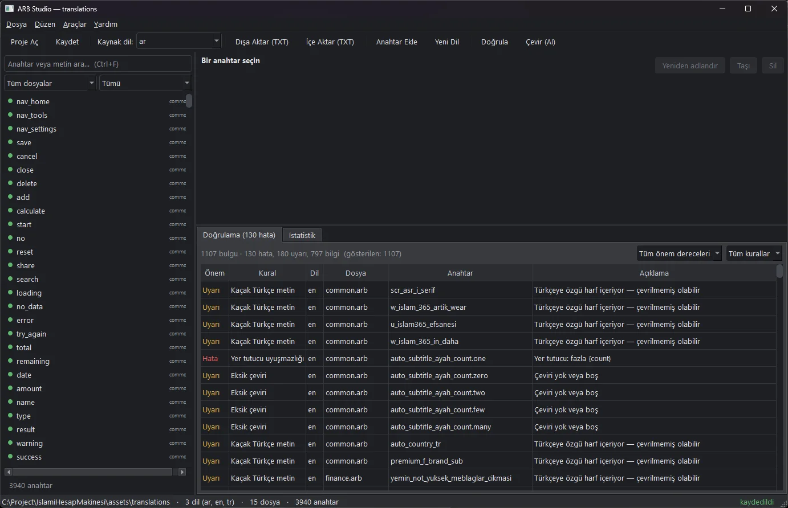

# ARB Studio

[English](README.md)

Flutter'ın `.arb` çeviri dosyaları için masaüstü editör. Bütün diller ve dosyalar tek pencerede. Bozuk yer tutucuları ve eksik çevirileri bulan bir doğrulayıcısı var. Metinleri TXT olarak dışarı alıp çevirdikten sonra geri yükleyebiliyorsun.

[İslam 365](https://islam365.app) için yazdım. Uygulamanın Türkçe, İngilizce ve Arapça metinleri 15 dosyaya bölünmüş, binlerce anahtardan oluşuyor. ARB dosyası kullanan her Flutter projesinde çalışır.

 -green) 



## İçindekiler

- [Başlarken](#başlarken)
- [TXT ile çeviri](#txt-ile-çeviri)
- [Doğrulama](#doğrulama)
- [Diğer özellikler](#diğer-özellikler)
- [Claude ile toplu çeviri](#claude-ile-toplu-çeviri)
- [Kısayollar](#kısayollar)
- [Bayt bayt aynı kaydetme](#bayt-bayt-aynı-kaydetme)
- [Desteklenen proje düzenleri](#desteklenen-proje-düzenleri)
- [Geliştirme](#geliştirme)

## Başlarken

### Windows için hazır exe

[Releases](../../releases) sayfasından `ArbStudio.exe` dosyasını indir. Tek dosya, yaklaşık 56 MB ve Python gerektirmiyor. Bir klasörü doğrudan açmak için klasörü exe'nin üstüne sürükle.

### Kaynaktan

Python 3.10 veya daha yenisi gerekiyor.

```powershell
git clone https://github.com/umitturkmen/ArbStudio.git
cd ArbStudio
.\run.bat
```

`run.bat` ilk çalıştırmada sanal ortamı kurar (PySide6 yaklaşık 120 MB), sonra uygulamayı açar. Elle kurmak ve bir proje klasörünü hemen açmak için:

```powershell
python -m venv .venv
.venv\Scripts\pip install -r requirements.txt
.venv\Scripts\python -m arbstudio uygulaman\assets\translations
```

## TXT ile çeviri

Asıl iş akışı şu: bir dilin bütün metinlerini dışarı al, istediğin yerde çevir, aynı sırayla geri yükle.

1. **Dışa Aktar (Ctrl+E):** Dili, kapsamı (bütün proje, tek bir `.arb` dosyası ya da listede seçili anahtarlar) ve biçimi seç.
2. TXT dosyasını istediğin araçla ya da bir çevirmenle çevir.
3. **İçe Aktar (Ctrl+I):** Dosyayı ve hedef dili seç, **Çözümle**'ye bas. Satır satır bir önizleme görürsün, değerler ancak onayladıktan sonra yerine oturur.
4. **Ctrl+S** ile diske yaz.

### İki biçim

| Biçim | Görünüşü | Ne zaman |
|---|---|---|
| **Satır bazlı** (varsayılan) | N. satır, N. anahtarın değeri | Toplu çeviri aracına yapıştırırken |
| **Anahtar + TAB + değer** | `nav_home<TAB>Ana Sayfa` | Sıra değişebilecekse ya da Excel'de açacaksan |

İçe aktarırken biçim kendiliğinden algılanır.

### Kaçış kuralları (satır bazlı biçim)

Her değer tek satıra sığmak zorunda, bu yüzden üç dizi kaçırılır:

| Gerçek | TXT'de |
|---|---|
| satır sonu | `\n` |
| sekme | `\t` |
| ters bölü | `\\` |

Çeviride `\n` gördüğün yere satır sonu koy, gerisine dokunma. Dönüşüm tam olarak geri çevrilebilir: İslam 365'teki bütün anahtarlar, çok satırlı değerler dahil, gidip geldikten sonra değişmeden kalıyor (`tests/test_txt_roundtrip.py`).

### Hizalama kontrolü

Her dışa aktarımda TXT'nin yanına bir `<isim>.arbmap.json` yazılır. İçinde anahtar sırası, satır sayısı ve her satırın yer tutucu parmak izi bulunur. İçe aktarırken ARB Studio:

- satır sayısı tutmuyorsa uyarır,
- kaymanın yakalandığı ilk satırı kaynak ve gelen metinle yan yana gösterir,
- ve hiçbir şey yazmadan önce onay ister.

## Doğrulama

**Ctrl+R** kontrolleri çalıştırır. Alt paneldeki bir bulguya çift tıklayınca ilgili anahtara gidersin.

| Kural | Neyi yakalar |
|---|---|
| Yer tutucu uyuşmazlığı | `{count}` kaynakta var ama çeviride yok, ya da tersi |
| Eksik çeviri | Anahtar hedef dilde yok ya da boş |
| Kaynakla aynı | Değer birebir kopya, büyük ihtimalle çevrilmemiş |
| Eksik çoğul grubu | `.one` var ama `.other` yok |
| Parite | Bir anahtar ya da dosya bir dilde var, diğerinde yok |
| Tutarsız çeviri | Aynı kaynak metin farklı şekillerde çevrilmiş |
| Boşluk farkı | Baştaki ya da sondaki boşluk kaynaktan farklı |
| Kaçak Türkçe metin | Türkçe olmayan bir dilde `ğşıçöü` içeren değer |

## Diğer özellikler

- **Anahtar yönetimi:** Ekle (Ctrl+N), yeniden adlandır (F2), sil ve başka bir `.arb` dosyasına taşı. Her değişiklik bütün dillere aynı anda uygulanır.
- **Yeni dil:** Kaynak dilin bütün `.arb` dosyalarını aynı anahtarlarla ve aynı sırayla kopyalar, değerleri boş bırakır ve `@@locale`'i ayarlar. Ardından Flutter tarafında yapman gerekenleri listeler (`l10n.dart`, `pubspec.yaml`, Android `locales_config.xml`, iOS `CFBundleLocalizations`). ARB Studio bu dosyalara dokunmaz.
- **Arama ve filtreler:** **Ctrl+F** anahtarlarda ve değerlerde arar. Dosyaya göre ya da Tümü, Çevrilmemiş, Kaynakla aynı, Yer tutuculu ve Sorunlu filtreleriyle daraltabilirsin. Listedeki her anahtarın yanında bir durum noktası ve dosya rozeti var.
- **İstatistik:** Her dosyanın ne kadar çevrildiğini gösteren dil × dosya tablosu.

## Claude ile toplu çeviri

**Araçlar → Çeviri Ayarları**'ndan Anthropic API anahtarını gir. `ANTHROPIC_API_KEY` ortam değişkeni tanımlıysa o önceliklidir. Sonra **Çevir (AI)**'ye bas:

- Kapsamı seç: çevrilmemişler, kaynakla aynı olanlar, bütün proje, tek dosya ya da seçili anahtarlar.
- Arka planda çalışır; ilerleme çubuğu ve durdurma düğmesi var.
- Dönen her satırın yer tutucuları kontrol edilir. Bozuk satırlar kırmızıyla işaretlenir ve varsayılan olarak seçili gelmez.
- Hiçbir şey doğrudan yazılmaz. Yan yana önizlemede her satırı sen onaylarsın.
- Token kullanımı ve yaklaşık maliyet gösterilir.

Anahtar proje klasöründe değil, Windows kullanıcı ayarlarında saklanır. Çeviri istemi İslam 365'e göre yazıldı; kendi uygulaman için `arbstudio/services/translator.py` içindeki `SYSTEM_PROMPT`'u değiştir.

## Kısayollar

| Kısayol | İşlem |
|---|---|
| `Ctrl+O` | Proje aç |
| `Ctrl+S` | Kaydet |
| `Ctrl+F` | Ara |
| `Ctrl+Enter` | Sonraki çevrilmemiş anahtar |
| `Ctrl+E` / `Ctrl+I` | Dışa / içe aktar |
| `Ctrl+N` / `F2` | Anahtar ekle / yeniden adlandır |
| `Ctrl+R` | Doğrula |
| `F5` | Projeyi yeniden yükle |

## Bayt bayt aynı kaydetme

ARB Studio bir dosyayı okurken satır sonunu (CRLF ya da LF), girintisini, BOM'unu, ASCII kaçışını ve sondaki satır sonunu not eder, yazarken de aynen uygular. Değiştirmediğin bir dosya yeniden kaydedilse bile baytları değişmez, böylece `git diff` sadece gerçekten değiştirdiğin satırları gösterir.

Kaydetmeden önce her dosyanın yanına bir `.arb.bak` yedeği bırakılır. Depodaki `.gitignore` bu yedekleri zaten yok sayıyor.

## Desteklenen proje düzenleri

Her dosyanın dil kodu şu sırayla bulunur:

1. **Klasör adı:** `assets/translations/tr/common.arb` → `tr`
2. **Dosya adı eki:** `lib/l10n/app_tr.arb` → `tr`, şablon dosya `app.arb`
3. **`@@locale` alanı**, ilk ikisi işe yaramazsa

Bozuk JSON içeren bir dosya projenin açılmasını engellemez. Atlanır ve proje açılırken bildirilir.

## Geliştirme

```powershell
.venv\Scripts\python -m pytest
```

Bazı testler İslam 365'in çeviri dosyalarıyla çalışır, o klasör bilgisayarında yoksa atlanır.

Tek dosyalık exe'yi üretmek için `build_exe.bat`'ı çalıştır. PyInstaller kullanıyor, bir iki dakika sürüyor ve sonunda bir öz test çalıştırıyor. Öz testi kendin de çalıştırabilirsin:

```powershell
dist\ArbStudio.exe ceviri\klasoru --selftest
```

Uygulamayı açar, arayüzü çizer, yol verilmişse projeyi yükler, bir özet yazar ve kapanır.

## Lisans

[MIT](LICENSE) © 2026 Ümit Türkmen
